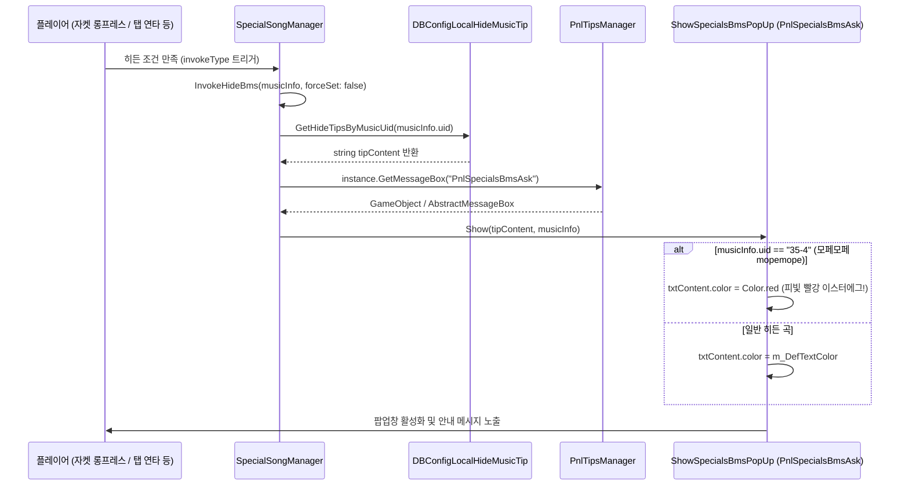

# 숨겨진 채보(Hidden Sheet) 로직 — ISIL 판독 기록

게임이 숨겨진 채보를 언제 열고, 열린 뒤 무엇을 바꾸고, 플레이할 때 어떤 차트를 불러오는지 ISIL로 읽은 기록입니다.
**조사만 했습니다.** 모드 코드에는 아무것도 반영하지 않았고, 게임 안 실측도 하지 않았습니다.

- 조사일: 2026-11-08
- 게임: Muse Dash 6.7.0 (`H:\muse dash hwa`, Il2Cpp)
- 출처
  - ISIL: `Cpp2IL.exe --game-path "H:/muse dash hwa" --output-as isil` → `IsilDump/Assembly-CSharp/SpecialSongManager.txt`, `SpecialSongManager_NestedType___c__DisplayClass41_0.txt`, `Assets/Scripts/UI/Panels/PnlStage.txt`, `StageBtnPlaySpecial.txt`
  - 필드 오프셋: `cpp2il_out/Assembly-CSharp.dll`에 `ilspycmd -t <타입>`

판독이 확실하지 않은 곳은 **(추정)**으로 표시했습니다.

---

## 1. 등장 타입과 필드

### `HideMusicInfo` (`DBConfigHideMusic`의 행, 서버/설정에서 옴)

| 오프셋 | 필드 | 의미 |
|---|---|---|
| 0x20 | `musicUid` | 곡 uid |
| 0x28 | `invokeType` | 발동 방식. `HideMapInvokeType`: 0 None, 1 LongPress (앨범 커버/자켓 길게 누르기), 2 DifficultySwitch, 3 MultiClick, 4 Other |
| 0x2C | `diffIndex` | 숨겨진 채보가 걸리는 난이도 칸 (1 Easy, 2 Hard, 3 Master) |
| 0x30 | `hideShowMaster` | (이번 판독 경로에서는 안 쓰임) |
| 0x34 | `changedIndex` | 실제로 불러올 채보 번호. 보통 4 → `<곡>_map4` |
| 0x38 | `handleType` | 발동 후 처리 방식. 0이면 곡별 하드코딩 분기, 0이 아니면 일반 경로 (4절) |

`DBConfigHideMusic`: `m_Items`(0x38, `List<HideMusicInfo>`), `m_HideMusicObjectMapping`(0x40, uid → `HideMusicInfo`).

### `SpecialSongManager.HideBmsInfo` (매니저가 만드는 런타임 사본)

| 오프셋 | 필드 | 값 |
|---|---|---|
| 0x10 | `musicUid` | |
| 0x18 | `triggerDiff` | `HideMusicInfo.diffIndex`. -1이면 난이도 무관 |
| 0x20 | `extraCondition` | `Func<bool>` |
| 0x28 | `resultMapName` | 바꿔 불러올 차트 에셋 이름 |
| 0x30 | `m_HideDiff` | `HideMusicInfo.changedIndex` |

생성자: `HideBmsInfo(string musicUid, int triggerDiff, int hideDiff, string resultMap, Func<bool> extraCondition = null)`

### `SpecialSongManager` 주요 필드

| 오프셋 | 필드 | 쓰임 |
|---|---|---|
| 0x28 | `m_HideBmsInfos` | uid → `HideBmsInfo` |
| 0x30 | `m_ConfigHideMusic` | `DBConfigHideMusic` |
| 0x40 | `m_RecordChangedValue` | 난이도 전환 기록 문자열 (DifficultySwitch) |
| 0x48 | `m_IsInvokeHideDic` | uid → 발동 여부 |
| 0x50 | `m_PrevMusicUid` | 연타 카운트 기준 곡 |
| 0x5C | `m_ClickTglIndex` | 연타 카운트 기준 난이도 탭 |
| 0x60 | `m_DiffTglClickCount` | 연타 카운트 |
| 0x68 | `m_GameInTime` | 날짜 이벤트 판정 시각 (`InitHideBmsInfoDic`에서 `DateTime.Now`) |

---

## 2. 데이터 준비 — `InitHideBmsInfoDic()`

1. `InitManager()`를 부르고 `m_GameInTime = DateTime.Now`를 저장합니다.
2. `m_HideBmsInfos`가 이미 있으면 끝냅니다. 한 번만 만듭니다.
3. `m_ConfigHideMusic.m_HideMusicObjectMapping`을 돌며 곡마다:
   - `diffIndex`와 `changedIndex`가 **둘 다 -1**이면 건너뜁니다.
   - `musicInfo = DBMusicTag.GetMusicInfoFromAll(uid)`
   - `resultMapName = string.Format("{0}{1}", musicInfo.mapName, changedIndex)` → 예: `xxx_map` + `4`
   - `extraCondition` = `<>c__DisplayClass41_0.<InitHideBmsInfoDic>b__2`
   - `new HideBmsInfo(uid, diffIndex, changedIndex, resultMapName, extraCondition)`를 사전에 넣습니다.
4. 날짜 이벤트 두 곡을 코드에서 직접 추가합니다.

| uid | triggerDiff | hideDiff | resultMap | extraCondition |
|---|---|---|---|---|
| `4-5` | 2 (Hard) | 4 | `goodtek_map4` | `b__41_0`: `m_GameInTime`이 **4월 1일** |
| `8-3` | -1 (무관) | 4 | `sweet_witch_girl_map4` | `b__41_1`: `m_GameInTime`이 **11월 1일** |

`b__2`의 본문은 `return __4__this.IsInvokeHideBms(pair.Key);`입니다. 순회 대상 곡의 키로 해당 곡이 이미 발동됐는지 판정합니다.

---

## 3. 플레이 시점 차트 교체 — `HideBmsCheck(MusicInfo selectedMusic, ref int selectedDifficulty)` → `string`

1. `InitHideBmsInfoDic()` (한 번만 만들어짐)
2. 전역 플래그(`GlobalDataBase` 정적 필드 0x38 객체의 0x10 bool, **(추정) 탄막 모드**)가 켜져 있고 `DBMusicTagDefine.GetBarrageIndex(uid) >= 0`이면
   `selectedDifficulty = 5`, `return null`.
3. `m_HideBmsInfos.TryGetValue(uid, out info)`가 실패하면 `null`.
4. `extra = info.extraCondition?.Invoke() ?? true`
   `diffOk = info.triggerDiff == -1 || info.triggerDiff == selectedDifficulty`
5. `extra && diffOk`이면 `selectedDifficulty = info.m_HideDiff`로 바꾸고 `info.resultMapName`을 돌려줍니다. 아니면 `null`.

즉 발동된 곡을 지정된 난이도 칸으로 시작하면, 난이도 번호가 4로 바뀌고 `<곡>_map4`가 로드됩니다.

---

## 4. 발동 방식

### 3 `MultiClick` — `OnDiffToggleClicked(int tglIndex, bool isOn)`

조건: 현재 곡의 `invokeType == 3`, `isOn`, 아직 발동 전.

```
if (m_PrevMusicUid != uid) { m_DiffTglClickCount = 1; m_PrevMusicUid = uid; }
if (m_ClickTglIndex != tglIndex) { m_DiffTglClickCount = 1; m_ClickTglIndex = tglIndex; }
m_DiffTglClickCount++;
if (m_DiffTglClickCount >= 10) InvokeHideBms(music);
```

같은 곡에서 같은 난이도 탭을 연달아 누르면 발동합니다. 리셋 직후 1에서 바로 2가 되므로 **약 9번 클릭**입니다.
`OnDiffClicked(MusicInfo, int, bool)`도 같은 카운트 로직이고, 여기에는 `invokeType` 검사가 없습니다(호출하는 쪽에서 거른다고 봄, **(추정)**).

### 2 `DifficultySwitch` — `OnDifficultyChanged(sender, rev, args)`

조건: `invokeType == 2`, 아직 발동 전. 곡이 바뀌면 기록을 비웁니다.
난이도가 바뀔 때마다 현재 난이도 번호를 `m_RecordChangedValue` 뒤에 붙이고, 기록에 **`"321232123"`**이 들어 있으면 `InvokeHideBms`를 부릅니다.
Master → Hard → Easy → Hard → Master → Hard → Easy → Hard → Master 순서입니다.

### 1 `LongPress` (앨범 커버/자켓 길게 누르기) — `StageBtnPlaySpecial.Update` → `HandleHideBms`

인게임 화면에서 플레이어가 **곡의 앨범 커버(자켓 일러스트) 영역을 꾹 누르고 있으면** 발동하는 로직입니다.
코드 상에서는 커버 영역에 오버레이된 컴포넌트 이름이 `StageBtnPlaySpecial`로 되어 있어 "플레이 버튼"처럼 보이지만, 실제로는 **커버(자켓)를 길게 누르는 인터랙션**입니다.

- `SpecialSongManager.IsSpecialMusic()`인 곡에서 커버 영역(`StageBtnPlaySpecial`)을 누르고 있으면 원형 링 게이지(`Image.fillAmount`, `btnPress`)가 차오릅니다. 게이지가 완충(필드 0x24 값에 도달)되면 `HandleHideBms`가 실행됩니다.
- 누른 채로 드래그해서 지정 거리(필드 0x38, `m_DeadDistance`)를 벗어나면 발동이 취소됩니다.
- **게이지가 완충되는 데 필요한 홀드 시간**은 C# 코드가 아닌 프리팹 직렬화 값이라 실측이 필요합니다.
- `86-0`, `86-1`, `86-4` (Rotaeno 콜라보 등)는 `HandleHideBms` 안에서 별도 분기를 타며 `PnlRotaenoSpecial` 패널을 띄우는 특수 연출이 있습니다.
- `PnlStage.OnInvokeLongPressHideBms`는 해금 후 곧바로 `OnBtnPlayClicked()`를 호출하여 배틀로 진입합니다.

### 전용 제스처 — `InputListener()`

현재 곡이 아직 발동 전일 때:
- `22-1`: `UpdateFDInput()`. 화면 사분면 기반 입력 기록(`RecordFDInput`, `GetScreenQuadrant`, `SetFDOperationInfo`)
- `34-5`: `UpdateXInput()`. X자 입력(`XInputCalc`)

세부 패턴(`m_OperationInfos`, `m_CircleData`)은 이번에 읽지 않았습니다.

### 날짜 강제 발동 — `PnlStage.SetHideDifficulty()`

- `BattleHelper.isFool`이면 `InvokeHideBms(4-5)`
- `BattleHelper.isHalloween`이면 `InvokeHideBms(8-3)`

---

## 5. 발동 여부 — `IsInvokeHideBms(string musicUid)`

| uid | 결과 |
|---|---|
| `42-0` | 전역 플래그(3절 2번과 같은 플래그, **(추정) 탄막 모드**)가 켜져 있으면 `true`. 꺼져 있으면 아래 사전 조회로 넘어갑니다 |
| `39-0`, `0-54`, `0-56`, `0-58`, `0-60` | 항상 `false` |
| 그 밖 | `m_IsInvokeHideDic.TryGetValue(uid)` 값 |

`InitHideInvoke()`는 `DBMusicTagDefine.GetAllHiddenMusicUids(buffer, normalHide, touhou)`로 숨겨진 곡 목록을 받아 `m_IsInvokeHideDic`을 채웁니다.

---

## 6. 발동 처리 — `InvokeHideBms(MusicInfo musicInfo, bool forceSet = false)`

공통 앞부분:
1. 이미 발동된 곡이고 `forceSet`이 아니면 끝냅니다.
2. 탄막 플래그가 켜져 있고 `DBMusicTagDefine.IsContainsBarrageSong(uid)`이면 `m_DiffTglClickCount = 0` 하고 끝냅니다.
3. `m_ConfigHideMusic` 매핑에서 `HideMusicInfo`를 찾고, `m_IsInvokeHideDic[uid] = true`를 씁니다.

### `handleType != 0` — 일반 경로

```
musicInfo.AddMaskValue($"difficulty{diffIndex}", musicInfo.difficulty4);
musicInfo.SetDifficulty(diffIndex, 4);
if (handleType == 1) musicInfo.AddMaskValue($"levelDesigner{diffIndex}", musicInfo.levelDesigner4);
if (invokeType == 1) EventManager.Invoke("UI/OnSpecialsMusic", ...);
if (!forceSet)
{
    // DBConfigLocalHideMusicTip 조회 후 PnlSpecialsBmsAsk 팝업 호출 (7절 참고)
}
```

지정 난이도 칸의 표시 레벨과 (선택적으로) 채보 제작자를 숨겨진 채보 값으로 가립니다. `AddMaskValue`라서 원본 필드를 고치지 않고 마스크로 덮습니다.

### `handleType == 0` — 곡별 하드코딩 분기

uid 문자열 해시로 갈라지는 switch입니다. 읽은 분기:

| uid | 처리 |
|---|---|
| `60-4` | `difficulty2` 마스크, `SetDifficulty`, `selectedDiffTglIndex` 변경 |
| `43-71`, `35-4` | `levelDesigner2`, `difficulty2` 마스크, `SetDifficulty` |
| `0-60` | `DBMusicTag.ReplaceMusic(..., "0-59")`, 탭 변경 |
| `66-5` | `difficulty3` 마스크, `SetDifficulty` |
| `51-4` | `"UI/OnSpecialsMusic"` 이벤트, 음원 이름에 `"2"`를 붙여 `AudioManager.PlayBGM`, `music` 마스크 |
| `0-56` | `"0-55"`로 교체 |
| `39-0` | `"39-8"`로 `ReplaceMusic`, 탭 변경, 음원 재생 |
| `0-58` | `"0-57"`로 교체 |
| `0-54` | `"0-53"`로 교체 |
| `41-0` / `41-5` | `difficulty2` 마스크, `music`을 `"heracles_sp_music"`로 |
| `4-5`, `8-3` | `difficulty1`/`difficulty3`을 `"0"`으로, `difficulty2` 마스크 |
| `21-2` | 앨범 현지화(`GetLocalAlbumInfoByIndex`) 조회 뒤 `name`을 `"Irreplaceable feat.AKINO with bless4"`로 |

분기별 세부 값(어떤 마스크에 무엇을 넣는지)은 일부만 확인했습니다. 쓰려면 해당 분기를 다시 읽어야 합니다.

---


---

## 7. 히든 해금 안내 팝업(`ShowSpecialsBmsPopUp`)과 모페모페(`35-4`) 이스터에그

플레이어가 히든 채보 조건을 만족했을 때 화면에 나타나는 안내 팝업창 시스템의 내부 구조입니다.



### 1) `ShowSpecialsBmsPopUp` 컴포넌트 구조

- **프리팹**: `PnlSpecialsBmsAsk` (UI 팝업 박스)
- **상속**: `AbstractMessageBox`
- **주요 필드**:
  - `0x68` (`104`): `txtContent` (Text / TextMeshProUGUI)
  - `0xE9` (`233`): `byte` 초기화 플래그
  - `0xF0` (`240`): `m_DefTextColor` (`UnityEngine.Color`, 기본 텍스트 색상)

### 2) `Show(string info, MusicInfo musicInfo)` 로직 및 모페모페(`35-4`) 이스터에그

`ShowSpecialsBmsPopUp.txt` ISIL 판독 결과:

```csharp
public override void Show(string info, MusicInfo musicInfo)
{
    // 1. 안내 메시지 텍스트 세팅
    base.MessageBoxText = info;

    // 2. 모페모페(35-4) 전용 하드코딩 이스터에그 검사
    if (musicInfo != null && musicInfo.uid == "35-4")
    {
        // 모페모페의 기괴하고 그로테스크한 악곡 분위기에 맞춰 글자색을 핏빛 빨간색으로 강제 변경
        this.txtContent.color = Color.red;
    }
    else
    {
        // 일반 곡은 프리팹 원본의 기본 텍스트 색상 적용
        this.txtContent.color = this.m_DefTextColor;
    }

    // 3. 팝업창 활성화 및 표시
    base.Show();
}
```

> [!NOTE]
> `35-4` (`mopemope`)는 꽃이 피어나는 귀여운 애니메이션 뒤에 급변하는 공포·그로테스크 연출로 유명한 악곡입니다. 제작진은 이 연출을 극대화하기 위해 히든 팝업 텍스트 렌더링 코드 자체에 `if (musicInfo.uid == "35-4")` 분기를 하드코딩하여 **빨간색 글씨(`Color.red`)**로 팝업을 띄우도록 특별 대우해 두었습니다.

### 3) 히든 안내 메시지 데이터 (`DBConfigLocalHideMusicTip`)

실제 게임 에셋 번들(`config_korean_assets_hidemusictip_korean`)에 등록된 주요 곡들의 안내 문구 예시:

| 곡 uid | 곡 제목 (참고) | 발동 유형 | 인게임 노출 안내 메시지 (`tipContent`) |
|---|---|---|---|
| `10-6` | Lights of Muse | LongPress (커버) | 자켓을 꾹 눌러 숨겨진 난이도를 해금하세요. |
| `35-4` | mopemope (모페모페) | MultiClick | 꽃을 연속으로 터치하여 난이도를 해금하세요. *(빨간색 글씨로 출력!)* |
| `43-71` | XODUS | DifficultySwitch | 상하로 빠르게 전환하여 난이도를 해금하세요. |
| `60-4` | Cthugha | MultiClick | 난이도를 반복해서 터치하여 해금하세요. |
| `86-0` | Rotaeno 콜라보 곡 | LongPress (커버) | 자켓을 길게 눌러 특수 연출 패널(`PnlRotaenoSpecial`) 진입 |

`DBConfigLocalHideMusicTip`은 클라이언트 현지화 텍스트 테이블이며, `GetHideTipsByMusicUid(uid)`는 곡 uid를 키로 조회하여 해당 언어의 팁 문자열을 반환합니다. 등록되지 않은 곡이거나 빈 문자열이면 팝업 없이 곧바로 발동 처리만 완료됩니다.

---

## 8. 커스텀 곡에 쓸 때 참고

- 커스텀 곡이 숨겨진 채보를 가지려면 `m_ConfigHideMusic` 매핑에 행이 있어야 합니다. `m_HideBmsInfos`는 한 번 만들어지면 다시 안 만들어지므로, 넣으려면 `InitHideBmsInfoDic` **이전**에 `DBConfigHideMusic`에 행을 넣거나, 이후에 `m_HideBmsInfos`에 직접 넣어야 합니다 **(추정, 미실험)**.
- 교체 차트 이름은 `musicInfo.mapName + changedIndex`입니다. 우리 모드의 가상 곡은 숙주 차트 에셋을 틀로 쓰므로(AGENTS.md 3절, `GetMusicDataFromStageInfo` Prefix), `_map4`가 숙주에 없으면 같은 대체 처리가 필요합니다.
- `HideBmsCheck`가 `selectedDifficulty`를 4로 바꾸므로, 난이도별 BMS(`BmsChartSet`)와 기록 키도 4번 난이도로 갑니다.
- 판정 조건이 상위 메서드에 명시되지 않는 경우 컴파일러 생성 클래스(`__c__DisplayClassNN_0`) 내부 호출 경로도 함께 확인해야 합니다.
